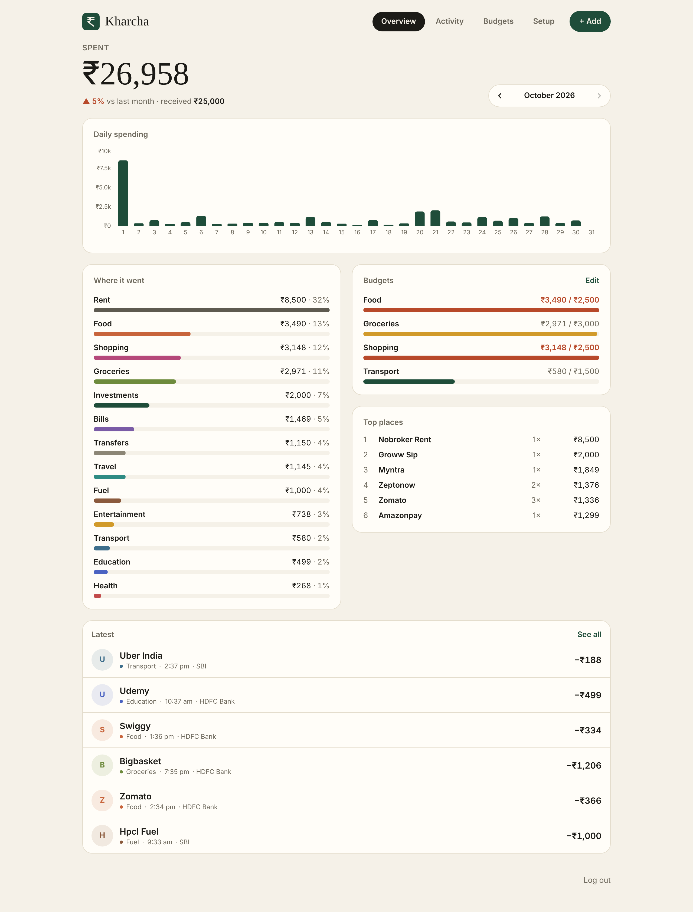
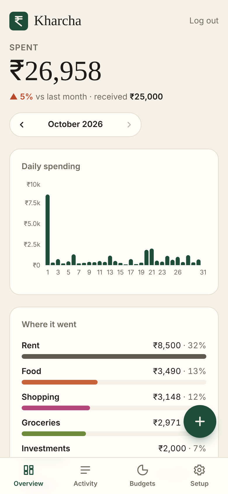
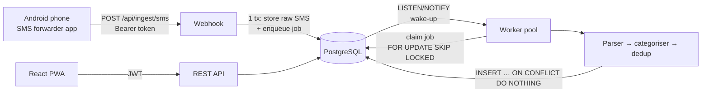

# Kharcha — automatic UPI expense tracker

Every time you pay with UPI, your bank sends you an SMS. Kharcha catches those texts, turns them into transactions, sorts them into categories, and shows where your money went this month. You don't type anything in.

<p>
  
  
</p>

**Stack:** TypeScript · Node.js (Fastify) · PostgreSQL · React + Vite + Tailwind · Kotlin (Android) · Docker · GitHub Actions

## Why SMS, not a UPI API?

Google Pay, PhonePe and Paytm have no public API for reading **your own** payments. Google Pay's API is for merchants and only covers payments made to that merchant. India's Account Aggregator network can share bank data, but using it with real accounts requires a regulated FIU licence. Your bank's SMS alerts are the one source that covers every UPI app at once, so Kharcha uses those.

## How it works



1. **Webhook** (`POST /api/ingest/sms`): checks the per-user token and drops anything that isn't a bank transaction, so personal texts are never stored. In **one database transaction** it saves the raw SMS and adds a job to the queue (the transactional-outbox pattern).
2. **Job queue** (`backend/src/queue`): a durable queue built on Postgres.
   - **Claiming:** workers claim jobs with `FOR UPDATE SKIP LOCKED` and hold them under a *lease*, which a heartbeat keeps extending.
   - **Crash recovery:** if a worker crashes, its lease runs out and another worker picks the job up. This gives at-least-once delivery.
   - **Retries:** failed jobs retry with exponential backoff plus jitter. After the last attempt they go to a dead-letter state, and you can replay them.
   - **Instant start:** `LISTEN/NOTIFY` wakes idle workers as soon as a job arrives, with polling as a fallback.
3. **Parser** (`backend/src/parser/sms.ts`): each bank formats its SMS differently. The parser pulls out the amount, direction, UPI reference, account number, counterparty, date and bank one field at a time. It rejects OTPs, collect requests, failed payments and due-date reminders.
4. **Dedup:** the same payment often arrives twice, for example by SMS and by email. Each transaction gets a unique key, `upi:<12-digit ref>:<direction>`, so the second copy is skipped. That also makes every job safe to re-run.
5. **Categories:** default rules come first (Swiggy → Food, IRCTC → Travel, personal UPI IDs → Transfers). When you change a category and tick *"Always put X under Y"*, Kharcha saves your own rule and applies it to past and future payments.

## Features

- Monthly overview: total spent, change vs last month, daily chart, category breakdown, top merchants
- Budgets per category with progress bars that warn you before you overspend
- Savings plan: enter your monthly salary (or allowance, for students) and a savings goal at sign-up. Kharcha suggests budgets from your usual spending. It keeps fixed costs (rent, bills, health, education, investments) as they are and trims everything else evenly to fit your goal.
- Activity list with search, category filters and keyset (cursor) pagination
- Manual entry for cash spending
- Recategorise one payment, or every payment to that merchant at once
- A message log that shows what the parser did with each SMS, with a **Re-parse** button
- CSV export, protected against spreadsheet formula injection
- Installable on your phone (PWA)

## Run it locally

You need Node 22 and Postgres 16, or Docker.

```bash
# Option A: Docker (everything in one command)
docker compose up --build              # → http://localhost:8080

# Option B: run it yourself
createdb kharcha                       # or use docker compose up db
cd backend && npm install && npm run dev       # API + worker on :8080 (migrations run automatically)
cd frontend && npm install && npm run dev      # UI on :5173, with /api proxied to :8080

# Fill it with 2 months of realistic bank SMS (log in as demo@kharcha.local / demo-password-123)
node backend/scripts/seed-demo.mjs
```

### Tests

```bash
createdb kharcha_test
cd backend && npm test        # 38 tests: parser + full pipeline against real Postgres
```

The tests cover:
- 12 bank SMS formats: HDFC (new and old), SBI, ICICI, Axis and Kotak, plus refunds and balance figures that must not be mistaken for the amount
- Rejection of OTPs, collect requests, failed payments, reminders and offers
- The webhook: idempotent when the forwarder retries, dedup across SMS and email wording, and keyset pagination
- The queue: retry, then dead-letter; a crashed worker's job being re-claimed after its lease expires (the old worker can't mark it complete); and **3 workers × 4 slots processing 300 jobs exactly once**

## Deploy for free

This deploys as **one container**, which serves the API, the worker and the React app. You add one free Postgres database.

1. **Database:** create a free Postgres on [Neon](https://neon.tech) and copy its **direct** (non-pooled) connection string (it ends with `?sslmode=require`). The pooled string, whose host contains `-pooler`, breaks the worker's `LISTEN/NOTIFY` wake-ups and the migration lock.
2. **App:** push this repo to GitHub. On [Render](https://render.com), create a **Web Service**, choose **Docker**, and set these environment variables:
   - `DATABASE_URL`: the Neon string
   - `JWT_SECRET`: run `node -e "console.log(require('crypto').randomBytes(32).toString('hex'))"`
   - `APP_TZ=Asia/Kolkata`, `NODE_ENV=production`
3. Open your Render URL, create your account, then set **`ALLOW_SIGNUP=false`** so nobody else can register on your server.
4. Open **Setup** in the app and follow the three steps to connect your phone.

> **Free tiers usually go to sleep when idle.** A sleeping server takes a while to wake, so the first SMS after a quiet spell can arrive late. Two fixes: point a free uptime pinger at `/api/health` every 10 minutes, or use a small always-on instance. Fly.io and Railway work too, since it's a standard Docker image.

## Connect your bank

### Android: the Kharcha app (automatic)

1. On your phone, open **Setup** in Kharcha and tap **Download the app** (`/kharcha.apk`). Allow your browser to install apps if Android asks.
2. Open the app, log in with your Kharcha account and server address. The app creates its own ingest token, so there's nothing to copy.
3. Tap **Allow** for SMS. The app sends the last 90 days of bank SMS once, then each new one as it arrives, through WorkManager so it survives being offline.

Only messages from bank-style sender IDs (like `VM-HDFCBK`) that mention an amount leave the phone; texts from people and OTPs never do (`android/app/src/main/java/app/kharcha/SmsFilter.kt`).

Build it yourself: install the Android SDK, then `cd android && ./gradlew assembleRelease` (add `-PkharchaServer=https://your-app` to pre-fill the server address). Copy `app/build/outputs/apk/release/app-release.apk` to `frontend/public/kharcha.apk`. The APK is signed with the debug key, which is fine for sharing directly. Use your own key before publishing on Google Play, which reviews apps that read SMS ("SMS-based money management").

### iPhone, or older months: upload a bank statement

**Setup → Upload a bank statement** takes your bank's CSV export or PDF statement, including password-protected PDFs. A PDF is turned into text in the browser, so the file itself never leaves your device. You see a preview first. Payments already recorded from SMS are matched by UPI reference and skipped, and uploading the same statement twice adds nothing.

### Any other SMS forwarder (advanced)

1. In **Setup → Advanced**, click **Create token**. Copy it now; it's shown only once.
2. In a forwarder such as *Incoming SMS to URL forwarder*, add a rule:
   - **URL:** `https://<your-app>/api/ingest/sms`
   - **Header:** `{"Authorization": "Bearer <token>"}`
   - **Body:** `{"from":"%from%","text":"%text%","receivedStamp":%receivedStamp%}`

If a bank message isn't parsed, copy it from the **Message log** into `backend/src/parser/sms.test.ts` as a new case, fix the heuristic until the test passes, then click **Re-parse**.

## API

| Method | Path | Notes |
|---|---|---|
| POST | `/api/auth/register`, `/api/auth/login` | Returns a JWT. Rate-limited to 10/min. |
| POST | `/api/ingest/sms` | Ingest token auth. Returns 202 queued, or 200 duplicate/ignored. |
| GET | `/api/transactions?month=&category=&q=&cursor=&limit=` | Keyset pagination |
| POST / PATCH / DELETE | `/api/transactions[/:id]` | PATCH `{category, applyToSimilar}` also saves a rule |
| GET | `/api/summary?month=YYYY-MM` | Totals, daily series, categories, merchants, budgets |
| GET / PUT | `/api/budgets` | |
| GET / PUT | `/api/plan` | Income, savings goal, and suggested budgets |
| POST | `/api/plan/apply` | Save the suggested budgets |
| GET | `/api/messages`, POST `/api/messages/:id/reparse` | Debug the parser |
| GET | `/api/jobs`, POST `/api/jobs/:id/retry` | Queue stats and dead-letter replay |
| GET | `/api/export.csv` | |
| POST | `/api/import/statement` | `{format: csv\|pdf, text, dryRun}`: preview, then import |

## Design decisions (good interview material)

- **Money is integer paise (`BIGINT`), never floats.** `0.1 + 0.2 ≠ 0.3`, and amounts are parsed from strings, so floating-point drift never creeps in.
- **Why a Postgres queue instead of Redis or Kafka?** At this scale Postgres is enough. It also gives you transactional enqueue: the job exists if and only if the raw message was saved. And it's one less service to run.
- **Why at-least-once delivery plus idempotent handlers, not exactly-once?** Exactly-once delivery isn't achievable across a crash. The practical alternative is delivering at least once and making each handler safe to repeat: the UPI reference is a natural idempotency key, enforced by a unique index.
- **Leases and heartbeats instead of holding a row lock for the whole job.** A long-running job would otherwise keep a transaction open the whole time. With leases, a worker that dies only delays a job by one lease period.
- **Keyset pagination on `(occurred_at, id)`.** Each page costs the same no matter how deep you scroll, and new rows arriving don't shift pages around (`OFFSET` has both problems).
- **Timezones:** a payment at 11:30 pm IST on the 31st belongs to that month. All month and day bucketing happens in `APP_TZ`.
- **Security:**
  - Passwords are hashed with scrypt.
  - Login takes the same time whether or not the email exists, so it doesn't reveal which emails are registered.
  - Only a hash of the ingest token is stored.
  - Webhook and login endpoints are rate-limited.
  - Personal SMS are never stored.
  - Sign-ups can be locked.
  - CSV exports are protected against formula injection.

## Roadmap

- [ ] Gmail bank-alert import (works for iPhone users), going through the same queue and dedup
- [x] Upload bank statement PDFs and CSVs to backfill history
- [ ] Excel (.xls/.xlsx) statements, and PhonePe/Paytm statement formats
- [ ] Detect recurring payments (subscriptions and EMIs)
- [ ] A push notification when a budget crosses 80%
- [ ] Prometheus `/metrics` endpoint (queue depth, job latency p99) and a Grafana dashboard
- [ ] A load-test report (k6) for the webhook
